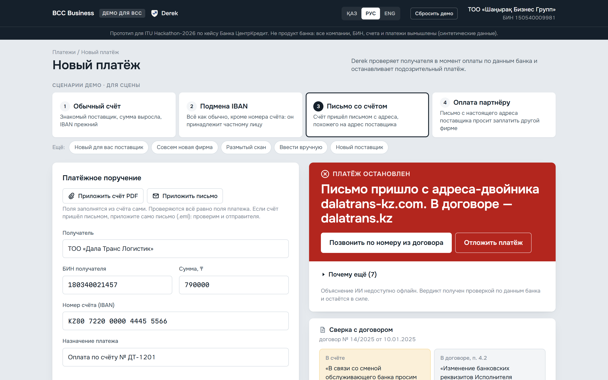
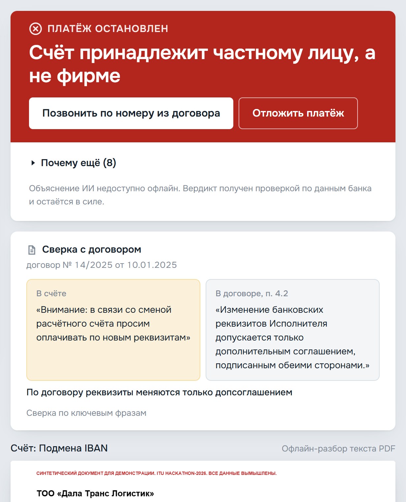
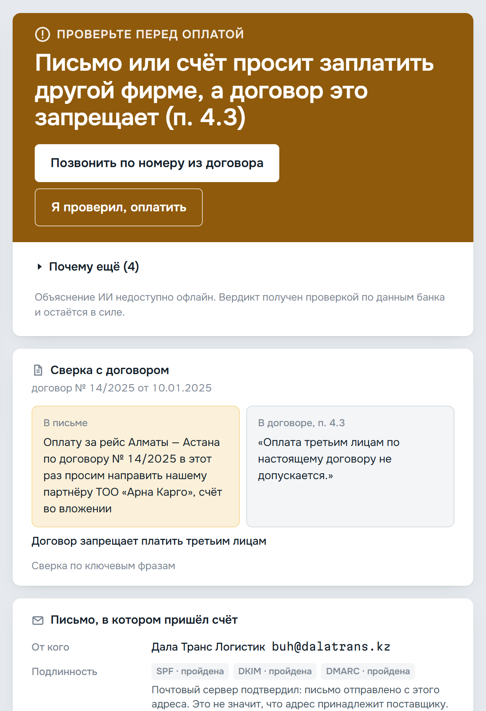
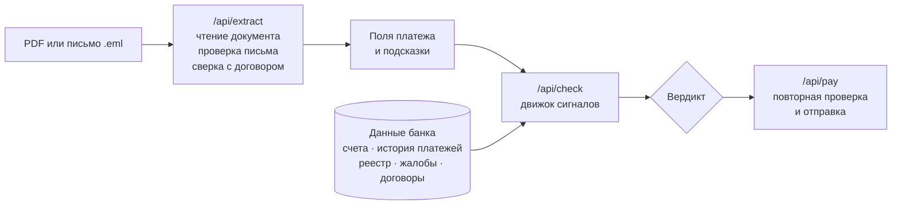

<div align="center">


<br>


**Проверка получателя внутри платёжки BCC Business**<br>
ITU Hackathon-2026 · кейс FINTECH от Банка ЦентрКредит

[Проблема](#-проблема) · [Что делает](#-что-делает-derek) · [Демо](#-демо-за-3-минуты) · [Запуск](#-быстрый-старт) · [ИИ и правила](#-ии-читает-решает-банк) · [Устройство](#-как-устроено)

</div>

<br>



<sub>Сценарий «Письмо со счётом»: письмо пришло с dalatrans-kz.com вместо dalatrans.kz из договора, и банк останавливает платёж. Все компании, счета, письма и платежи в демо синтетические.</sub>

---

## 🎯 Проблема

Мошенник взламывает почту поставщика и присылает бухгалтеру обычный счёт: тот же логотип, та же сумма, тот же договор. Отличается только номер счёта, иногда с припиской «у нас сменился банк». Бухгалтер спокойно платит, и деньги уходят мошеннику. Вернуть их почти невозможно, потому что клиент перевёл их сам.

Банковский антифрод такой платёж не ловит. Он ищет панику, звонки и спешку, а здесь всё выглядит как обычная работа.

<table>
<tr>
<td align="center" width="33%"><h3>$3 млрд</h3>потерь бизнеса от подмены писем и счетов в США за 2025 год</td>
<td align="center" width="33%"><h3>№ 2</h3>по ущербу среди всех киберпреступлений</td>
<td align="center" width="33%"><h3>~$120 тыс.</h3>в среднем на один случай</td>
</tr>
</table>

<sub>Источник: FBI IC3 Internet Crime Report 2025 (Business Email Compromise). Отдельной статистики по Казахстану нет: такие потери входят в общие цифры онлайн-мошенничества.</sub>

## 🛡 Что делает Derek

В момент оплаты банк задаёт платежу вопросы, на которые у бухгалтера нет ответа:

| | Вопрос | Пример ответа на экране |
|:-:|---|---|
| 🔑 | **Чей это счёт?** | «Счёт принадлежит частному лицу, а не фирме» |
| 🕘 | **Куда вы платили раньше?** | «Вы 6 раз платили этой фирме на другой счёт» |
| 👥 | **Куда платят другие клиенты банка?** | «48 клиентов банка платят этой фирме на другой счёт» |
| 🏢 | **Что это за фирма?** | «Фирма зарегистрирована 14 дней назад» |
| ✉️ | **Откуда пришло письмо?** | «Письмо пришло с адреса-двойника dalatrans-kz.com. В договоре — dalatrans.kz» |
| 📄 | **Что сказано в договоре?** | «Письмо или счёт просит заплатить другой фирме, а договор это запрещает (п. 4.3)» |

Ответ один из трёх: 🔴 **Платёж остановлен** · 🟡 **Проверьте перед оплатой** · 🟢 **Получатель подтверждён**. Причину Derek показывает одну, главную, простыми словами, а рядом понятное действие, например «Позвонить по номеру из договора».

> **Главная находка: третий вопрос.** Даже при первой оплате новому поставщику банк видит, куда ему платят другие клиенты. Бухгалтер получает только число, без названий и сумм чужих клиентов.

## 🎬 Демо за 3 минуты

<table>
<tr>
<td width="50%" valign="top">
<b>2 · Подмена IBAN</b> 🔴<br>
<sub>Тот же счёт, но номер принадлежит частному лицу</sub><br><br>

</td>
<td width="50%" valign="top">
<b>4 · Оплата партнёру</b> 🟡<br>
<sub>Письмо с настоящего адреса просит заплатить другой фирме</sub><br><br>

</td>
</tr>
</table>

| # | Сценарий | Что приходит | Что показывает Derek |
|:-:|---|---|---|
| 1 | **Обычный счёт** | PDF от знакомого поставщика | 🟢 «Получатель подтверждён» |
| 2 | **Подмена IBAN** | Тот же счёт, другой номер | 🔴 «Счёт принадлежит частному лицу», номер подсвечен в PDF |
| 3 | **Письмо со счётом** | Письмо `.eml` с адреса-двойника | 🔴 «Письмо пришло с адреса-двойника», фразы давления подсвечены |
| 4 | **Оплата партнёру** | Письмо просит заплатить другой фирме | 🟡 Цитата из письма рядом с пунктом договора |

<details>
<summary><b>Подсказки для выступления</b></summary>

<br>

- Выбор сценария только заполняет форму. Проверку запускает кнопка «Оплатить».
- Перед выходом на сцену нажмите «Сбросить демо».
- В сценарии 3 в карточке звонка нажимайте «Не подтвердил»: подтверждение смены реквизитов не снимает стоп по адресу-двойнику.
- Запасные сценарии для вопросов жюри: «Новый для вас поставщик», «Совсем новая фирма», «Размытый скан», «Ввести вручную», «Новый поставщик».

</details>

## 🚀 Быстрый старт

Нужен **Node.js 24**.

```bash
npm install
cp .env.example .env.local   # необязательно: ключи ИИ
npm run dev                  # http://localhost:3000
```

**Сцена без интернета**

```bash
npm run build
DEREK_STAGE=1 npm start      # PowerShell: $env:DEREK_STAGE="1"; npm start
```

В режиме `DEREK_STAGE=1` приложение не обращается к сети. Документы читаются локальным разбором, письмо и договор проверяются по ключевым фразам, вердикт работает полностью.

**С ИИ.** Добавьте ключ в `.env.local`:

| Переменная | Что даёт |
|---|---|
| `GROQ_API_KEY` | `openai/gpt-oss-120b` читает счёт, ищет давление в письме, сверяет документы с договором и объясняет вердикт |
| `ANTHROPIC_API_KEY` | Claude читает PDF целиком, включая сканы (если нет ключа Groq) |

Без ключей и при ошибке ИИ работает локальный разбор.

## 🧠 ИИ читает, решает банк

| 🤖 Делает ИИ | 🏦 Решают правила банка |
|---|---|
| Извлекает реквизиты из PDF любой вёрстки | Чей счёт, история платежей, реестр, жалобы |
| Находит в письме давление: «оплатите сегодня», «не звоните» | Адрес-двойник, проверка отправителя почтовым сервером |
| Сверяет письмо и счёт с пунктами договора | Итоговый вердикт и отправка платежа |
| Объясняет вердикт человеческим языком | |

Четыре правила, на которых держится доверие:

1. **ИИ не ставит «стоп» и не смягчает вердикт.** Находки ИИ дают только уровень «проверьте».
2. **Только дословные цитаты.** Цитата показывается, только если слово в слово есть в документе. Выдуманные моделью отбрасываются.
3. **Решает сервер.** `/api/pay` заново проверяет платёж и отправляет только проверенную версию. Остановленный платёж нельзя отправить даже поддельным запросом.
4. **Приватность.** О других клиентах банка показываются только агрегаты, например «48 клиентов».

## ⚙️ Как устроено



| Часть | Где | Что делает |
|---|---|---|
| Движок сигналов | `lib/signals/` | Чистая функция без весов и баллов: 30 сигналов четырёх уровней, вердикт по самому серьёзному |
| Письмо | `lib/email/` | Разбор MIME, домен-двойник, бесплатная почта, Reply-To, давление |
| Договор | `lib/contract/` | Смена реквизитов без допсоглашения и оплата третьим лицам |
| Синтетический банк | `lib/bank/`, `data/bank/` | Детерминированный генератор: клиенты, поставщики, платежи, счета BCC, реестр, жалобы, договоры |
| Экран | `app/`, `components/` | Форма, вердикт, карточка звонка, панели письма и договора, PDF с подсветкой |

<details>
<summary><b>Структура репозитория</b></summary>

```
app/            экран и API: extract, check, pay, approvals, explain
components/     PaymentForm, VerdictPanel, ContactCard, EmailPanel, ContractPanel, PdfView
lib/signals/    разбор полей, движок, тексты kk/ru/en
lib/email/      разбор .eml, домены, давление
lib/contract/   сверка с договором
lib/bank/       синтетический банк и утверждения смены реквизитов
data/bank/      сгенерированные данные (npm run gen:bank)
public/samples/ демо-счета PDF и письма .eml
scripts/        генераторы данных, счетов и писем
tests/          284 автотеста
docs/           дизайн-документы, планы, картинки README
```

</details>

<details>
<summary><b>Проверки</b></summary>

```bash
npm test             # 284 теста: каждый сигнал, сценарии, API, обход проверки
npx tsc --noEmit     # типы
npm run lint         # линтер
npm run gen:bank     # пересоздать синтетические данные банка
```

</details>

## 🗺 Путь внедрения

| Шаг | Что | |
|:-:|---|---|
| 1 | **BCC Business** | Проверка на каждом платеже по данным, которые у банка уже есть |
| 2 | **Подтверждённые реквизиты** | Поставщик регистрирует свой счёт и ставит QR банка на счёт |
| 3 | **Другие схемы** | Письмо «от директора», смена зарплатного счёта, взлом интернет-банка |
| 4 | **Все банки страны** | Обмен данными о владельцах счетов между банками, как в Европе |

## ⚖️ Честно об ограничениях

- Владельца счёта Derek проверяет только для счетов BCC. Для других банков нужен обмен данными между банками (шаг 4).
- Подсказки из письма и договора приходят от браузера клиента. Убрав их, клиент может лишь пропустить предупреждение для себя, но не снять стоп.
- Отдельной статистики подмены счетов по Казахстану нет.

## 📚 Документы

[Экран платежа и сигналы](docs/superpowers/specs/2026-11-25-payment-screen-signals-design.md) · [Проверка письма](docs/superpowers/specs/2026-11-26-email-check-design.md) · [Сверка с договором](docs/superpowers/specs/2026-11-27-contract-check-design.md)

<div align="center">
<br>
<sub>Прототип для ITU Hackathon-2026. Не продукт банка: все компании, БИН, счета, письма и платежи вымышлены.</sub>
</div>
