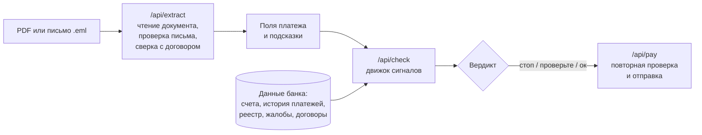

# Derek

**Банк останавливает платёж по поддельному счёту в момент, когда бухгалтер нажимает «Оплатить».**

Прототип для ITU Hackathon-2026, кейс FINTECH от Банка ЦентрКредит (BCC). Derek встроен в экран «Новый платёж» BCC Business и проверяет получателя по данным, которые есть только у банка.

> Все компании, БИН, счета, телефоны, письма и платежи в демо синтетические.

---

## Проблема

Мошенник взламывает почту поставщика и присылает бухгалтеру обычный счёт: тот же логотип, та же сумма, тот же договор. Отличается только номер счёта, иногда с припиской «у нас сменился банк». Бухгалтер спокойно платит, и деньги уходят мошеннику. Вернуть их почти невозможно: клиент перевёл их сам.

Банковский антифрод такой платёж не ловит. Он настроен на панику, звонки и спешку, а здесь всё выглядит как обычная работа. По данным FBI IC3 за 2025 год, подмена писем и счетов — второе по ущербу киберпреступление: около $3 млрд потерь бизнеса в США.

## Что делает Derek

В момент оплаты банк задаёт платежу вопросы, на которые у бухгалтера нет ответа:

| Вопрос | Пример ответа на экране |
|---|---|
| **Чей это счёт?** | «Счёт принадлежит частному лицу, а не фирме» |
| **Куда вы платили раньше?** | «Вы 6 раз платили этой фирме на другой счёт» |
| **Куда платят другие клиенты банка?** | «48 клиентов банка платят этой фирме на другой счёт» |
| **Что это за фирма?** | «Фирма зарегистрирована 14 дней назад», «Фирмы с таким БИН не существует» |
| **Откуда пришло письмо со счётом?** | «Письмо пришло с адреса-двойника dalatrans-kz.com. В договоре — dalatrans.kz» |
| **Что сказано в договоре?** | «Письмо или счёт просит заплатить другой фирме, а договор это запрещает (п. 4.3)» |

Результат один из трёх: **«Платёж остановлен»**, **«Проверьте перед оплатой»** или **«Получатель подтверждён»**. Причина главная одна, простыми словами, а рядом понятное действие, например «Позвонить по номеру из договора». Остальные причины открываются по кнопке «Почему ещё». Тексты есть на казахском, русском и английском.

Третий вопрос защищает даже при первой оплате новому поставщику. Бухгалтер видит только число других клиентов, без их названий и сумм.

## Демо за 3 минуты

Четыре сценария на сцене. Выбор сценария только заполняет форму, проверку запускает кнопка «Оплатить».

| # | Сценарий | Что приходит | Что показывает Derek |
|---|---|---|---|
| 1 | **Обычный счёт** | PDF от знакомого поставщика | 🟢 «Получатель подтверждён» |
| 2 | **Подмена IBAN** | Тот же счёт, другой номер | 🔴 «Счёт принадлежит частному лицу, а не фирме», номер подсвечен в PDF |
| 3 | **Письмо со счётом** | Письмо `.eml` с адреса-двойника, внутри счёт в другом банке | 🔴 «Письмо пришло с адреса-двойника», фразы давления подсвечены |
| 4 | **Оплата партнёру** | Письмо с настоящего адреса поставщика просит заплатить другой фирме | 🟡 «Договор это запрещает (п. 4.3)», цитата из письма рядом с пунктом договора |

Запасные сценарии для вопросов жюри: «Новый для вас поставщик», «Совсем новая фирма», «Размытый скан», «Ввести вручную», «Новый поставщик».

Перед выходом на сцену нажмите «Сбросить демо». В сценарии 3 в карточке звонка нажимайте «Не подтвердил»: подтверждение смены реквизитов не снимает стоп по адресу-двойнику.

## Быстрый старт

Нужен **Node.js 24**.

```bash
npm install
cp .env.example .env.local   # необязательно: GROQ_API_KEY и/или ANTHROPIC_API_KEY
npm run dev                  # http://localhost:3000
```

### Сцена: без интернета

```bash
npm run build
DEREK_STAGE=1 npm start      # PowerShell: $env:DEREK_STAGE="1"; npm start
```

В режиме `DEREK_STAGE=1` приложение не обращается к сети. Документы читаются локальным разбором, давление в письме и расхождения с договором ищутся по ключевым фразам, проверка работает полностью. Одинаковый платёж всегда получает одинаковый ответ.

### С ИИ

Добавьте ключ в `.env.local`:

| Переменная | Что даёт |
|---|---|
| `GROQ_API_KEY` | `openai/gpt-oss-120b` читает счёт, ищет давление в письме, сверяет документы с договором и объясняет вердикт |
| `ANTHROPIC_API_KEY` | Claude читает PDF целиком, включая сканы (используется, если нет ключа Groq) |

Без ключей, при ошибке ИИ или в режиме сцены работает локальный разбор.

## ИИ читает, решает банк

| Делает ИИ | Решают правила банка |
|---|---|
| Извлекает реквизиты из PDF любой вёрстки | Чей счёт, история платежей, реестр, жалобы |
| Находит в письме давление: «оплатите сегодня», «не звоните» | Адрес-двойник, подпись почтового сервера |
| Сверяет письмо и счёт с пунктами договора | Итоговый вердикт и отправка платежа |
| Объясняет вердикт человеческим языком | |

Правила, на которых держится доверие:

- **ИИ не может поставить «стоп» или смягчить вердикт.** Находки ИИ дают только уровень «проверьте».
- **Только дословные цитаты.** Цитата из письма или договора показывается, только если она слово в слово есть в документе. Выдуманные модели отбрасываются.
- **Решает сервер.** `/api/pay` заново проверяет платёж и отправляет только ту версию, которую проверил. Остановленный платёж нельзя отправить даже поддельным запросом.
- **Приватность.** Клиент видит о других клиентах банка только агрегаты, например «48 клиентов», без названий и сумм.

## Как устроено



- **Движок сигналов** (`lib/signals/engine.ts`) — чистая функция без весов и баллов. Вердикт определяется самым серьёзным сигналом: 30 сигналов четырёх уровней: стоп, проверьте, информация, подтверждение.
- **Письмо** (`lib/email/`) — разбор MIME, домены (двойник, бесплатная почта, Reply-To), поиск давления.
- **Договор** (`lib/contract/compare.ts`) — сверка документов с пунктами об оплате: смена реквизитов без допсоглашения и оплата третьим лицам.
- **Синтетический банк** (`lib/bank/`, `data/bank/`) — детерминированный генератор: клиенты, поставщики, история платежей, счета BCC, мини-реестр, жалобы, договоры.
- **Экран** (`app/page.tsx`, `lib/usePaymentScreen.ts`, `components/`) — форма, вердикт, карточка звонка, панели «Письмо» и «Сверка с договором», PDF с подсветкой.

### Структура

```
app/            экран и API: extract, check, pay, approvals, explain
components/     PaymentForm, VerdictPanel, ContactCard, EmailPanel, ContractPanel, PdfView
lib/signals/    разбор полей, движок, тексты kk/ru/en
lib/email/      разбор .eml, домены, давление
lib/contract/   сверка с договором
lib/bank/       синтетический банк и утверждения смены реквизитов
data/bank/      сгенерированные данные (npm run gen:bank)
public/samples/ демо-счета PDF и письма .eml
scripts/        генераторы данных, счетов и писем
tests/          284 автотеста
docs/           дизайн-документы и планы
```

## Проверки

```bash
npm test             # 284 теста: каждый сигнал, сценарии, API, обход проверки
npx tsc --noEmit     # типы
npm run lint         # линтер
npm run gen:bank     # пересоздать синтетические данные банка
```

## Ограничения

- Владельца счёта Derek проверяет только для счетов BCC. Для других банков нужен обмен данными между банками: это шаг 4 плана внедрения.
- Подсказки из документа (письмо, договор) приходят от браузера клиента. Убрав их, клиент может лишь пропустить предупреждение для себя, но не снять стоп.
- Отдельной статистики подмены счетов по Казахстану нет: такие потери входят в общие цифры онлайн-мошенничества.

## Документы

- [Экран платежа и сигналы](docs/superpowers/specs/2026-11-25-payment-screen-signals-design.md)
- [Проверка письма](docs/superpowers/specs/2026-11-26-email-check-design.md)
- [Сверка с договором](docs/superpowers/specs/2026-11-27-contract-check-design.md)

Название продукта меняется в одном месте: `lib/brand.ts`.
